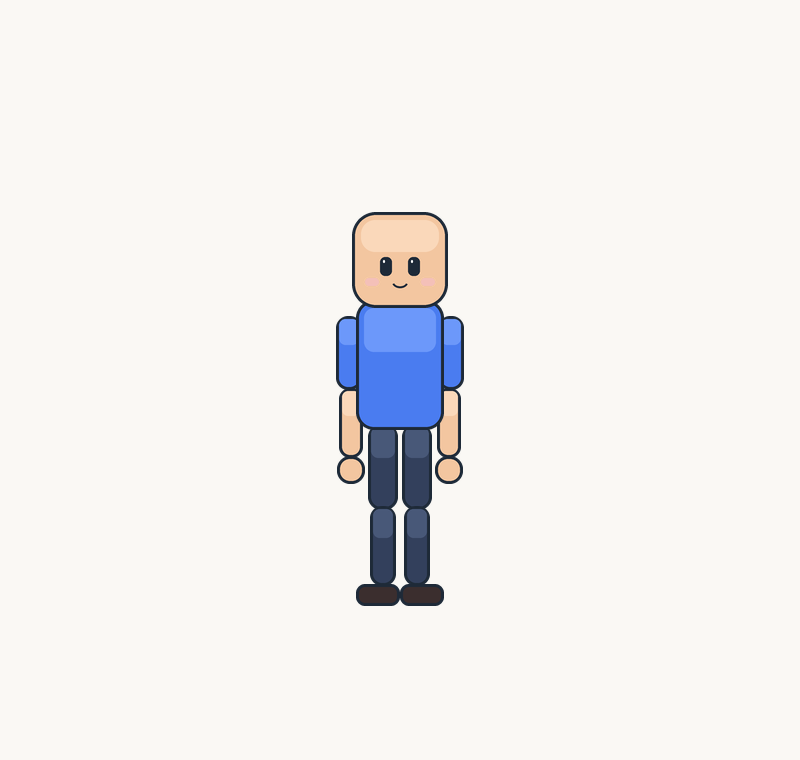

# 第 1 课 · 认识 Spine

> **预计时间：50 分钟**（阅读 15 分钟 + 动手 35 分钟）
> **本课目标：** 不再害怕界面，理解 Spine 的"三个模式 + 一棵树"，并亲手让一张图跟着骨头转起来。
> **本课不追求：** 做出好看的动画。今天只求"通了"。

> ⚠️ 你的界面是简体中文。下面我写成 `英文 (中文)` 的形式。
> 中文译名可能和你的版本略有出入，**认位置比认字更可靠**。

---

## 一、先建立一个心智模型：Spine 到底在干什么

想象一个**提线木偶**：

- 木偶有一副**骨架**，关节之间连着小木棍 → 这就是 **Bone（骨骼）**
- 每个关节上挂着几个**小钩子**，钩子决定了纸片挂在哪儿、谁在前谁在后 → 这就是 **Slot（插槽）**
- 钩子上挂着一张张**纸片**，纸片上画着胳膊、腿、头 → 这就是 **Attachment（附件）**
- 有人按着时间，一根根拨动木棍 → 这就是 **Animation（动画）**

Spine 做的就是这套东西的数字化版本。你导入的每一张 PNG，最后都变成某个钩子上的一张"纸片"。

**记住这张图，后面 19 节课都在它上面展开：**

```
Skeleton（骨架 / 一个角色）
└─ Bone 骨骼（关节，有父子关系，父动子一定动）
   └─ Slot 插槽（挂在骨骼上的挂点：管"显示什么"和"谁在前面"）
      └─ Attachment 附件（具体那张图 / 那个网格）
Animation 动画（按时间记录：骨骼怎么转、插槽显示哪个附件）
```

---

## 二、三种模式：Spine 最重要的一个概念

打开 Spine，视口左上角有三个按钮（也可能在顶部工具栏）：

| 模式 | 英文 | 你在里面做什么 | 类比 |
|---|---|---|---|
| **设置** | **Setup** | 搭骨架、绑图片、设网格、定"标准姿势" | 造木偶 |
| **姿势** | **Pose** | 临时摆个姿势看效果，**不改**骨架也**不记录** | 拿在手里试摆 |
| **动画** | **Animate** | 打关键帧、做动画 | 操纵木偶表演 |

**切换 Setup / Animate 的快捷键：`Ctrl + Tab`**

### 为什么这个最重要？

> **90% 的新手错误，都是在 Animate 模式里改骨架。**

在 Animate 模式里动骨骼，Spine 会认为"你在做动画"，自动给你打上关键帧。
结果就是：你本来想调一下角色的静态姿势，却莫名其妙多出一堆动画数据，越改越乱。

**黄金法则：**

> **搭建 → Setup　测试 → Pose　做动画 → Animate**

不确定的时候，先按 `Ctrl + Tab` 回到 Setup，看一眼角色的"标准姿势"还在不在。

---

## 三、界面导览：五个区域

Spine 的界面很"专业软件"，但只有五个区域需要认识。

```
┌──────────────────────────────────────────────────────┐
│ 菜单栏：文件 编辑 视图 骨骼 插槽 约束 图片 网格 动画 帮助   │
├──────────┬───────────────────────────────┬───────────┤
│          │  视口工具栏                    │           │
│  ① 树    │  旋转C 平移V 缩放X 切变Z       │  ③ 属性   │
│ (Tree)   │  姿势B 创建N 权重G             │ (Properties)│
│          │                               │           │
│  骨骼    │      ② 视口 (Viewport)         │  选中什么东西│
│  插槽    │        角色在这里              │  就在这里改  │
│  图片    │                               │           │
│          │                               │           │
├──────────┴───────────────────────────────┴───────────┤
│  ④ 时间轴 / 摄影表 / 曲线                              │
│     Time    Keys    Graph                             │
└──────────────────────────────────────────────────────┘
```

### ① 左侧树（Tree / Hierarchy）

整个骨架的**目录**。每一个东西都在这里，缩进代表父子关系。

- 展开 `Skeleton` 能看到 `Bones`、`Slots`、`Constraints`、`Images` 等分类
- **拖动一个节点到另一个节点上 = 改父子关系**
- 改错了：`Ctrl + Z`

### ② 视口（Viewport）

你"看"和"点"的地方。

| 操作 | 方式 |
|---|---|
| 缩放 | 鼠标滚轮 |
| 平移 | 按住鼠标中键拖动（你的版本也可能是右键） |
| 视图适配 | `Ctrl + Shift + F` |
| 100% 显示 | `Ctrl + F` |
| 全局撤销 | `Ctrl + Z` |

> 如果平移手势不对：按 `Ctrl + Shift + K` 打开**快捷键气泡**，
> 把鼠标悬停在界面元素上就会显示它的按键——这是你这台机器的真实键位。

### ③ 右侧属性（Properties）

**选中谁，这里就显示谁的参数。** 这是 Spine 里用得最多的地方。

- 选中骨骼 → 位置、旋转、缩放、父骨骼
- 选中插槽 → 显示哪个附件、颜色、绘制顺序
- 选中动画 → 时长、帧率

### ④ 底部时间轴（Timeline / Dopesheet / Graph）

做动画的地方。先认识标签页就够了：

- **Timeline（时间轴）**：当前选中对象的关键帧
- **Dopesheet（摄影表）**：所有对象的关键帧总览
- **Graph（曲线）**：关键帧之间的速度曲线

快捷键：`Alt + L` 时间轴　`Alt + D` 摄影表　`Alt + G` 曲线
`F9` 可以把这些面板最小化，腾出视口。

### ⑤ 视口工具栏（常用工具）

| 工具 | 快捷键 | 用途 |
|---|---|---|
| 旋转 Rotate | `C` | 转骨骼（做动画用得最多） |
| 平移 Translate | `V` | 移动骨骼/附件 |
| 缩放 Scale | `X` | 拉伸 |
| 切变 Shear | `Z` | 倾斜（少用） |
| 姿势 Pose | `B` | 像捏人偶一样直接拖 |
| 创建 Create | `N` | 新建骨骼等 |
| 权重 Weights | `G` | 刷权重（第 5 课） |

**常用键记住这几个就够：** `C` 转、`V` 移、`Ctrl+Tab` 切模式、`Ctrl+S` 保存、`Ctrl+Z` 撤销。

---

## 四、动手 A：拆解官方示例（15 分钟）

这是**最有效的学习方式**——先看一个专业作品长什么样。

打开 Spine 自带的示例工程：示例目录 `examples/4.3/spineboy/` 里的 **`spineboy-pro.spine`**。

> 打开后如果在 Animate 模式、角色摆着奇怪的姿势，不用慌，这很正常。

**带着问题去看，看完在 `笔记\` 里写答案：**

- [ ] **1. 数骨骼**
  左侧树展开 `Bones`。数一数大概有多少根？找出 `root`、`hip`、`torso`。
  注意**缩进**——`hip` 在 `root` 下面，说明 hip 是 root 的子骨骼。

- [ ] **2. 看一眼"父子关系"的威力**
  选中 `root`，用旋转工具（`C`）转一下。
  整个角色是不是一起转了？因为所有骨骼都是它的子孙。
  → **做完按 `Ctrl + Z` 撤销，不要改别人的示例文件。**
  （保险起见：不要按 `Ctrl + S`）

- [ ] **3. 数插槽**
  展开 `Slots`。看看顺序：靠上的插槽画在前面还是后面？
  在视口里选中角色的某个部件，用 `+` / `-`（或右键菜单里的 Draw Order）调一下顺序，看它跑到前面还是后面。
  → 看完撤销。

- [ ] **4. 看动画**
  `Ctrl + Tab` 切到 **Animate** 模式。
  底部动画面板里应该有一个动画列表（`idle`、`walk`、`run`、`jump` 之类）。
  选 `walk`，按 `D` 播放，按 `Ctrl + R` 开启循环。

- [ ] **5. 看关键帧**
  播放时观察底部时间轴：那些小菱形就是**关键帧（Key）**。
  按 `w` / `s` 可以在关键帧之间跳。

- [ ] **6. 回到标准姿势**
  切回 Setup（`Ctrl + Tab`），再按 `Ctrl + Shift + J`（Setup Pose），角色会回到标准姿势。

**观察完，关掉示例（不要保存）。** 你已经在脑子里装了一个"专业作品"的样板。

---

## 五、动手 B：从零做出你的第一根骨骼（25 分钟）

我们要用的素材，我已经给你准备好了：一位**方块小哥**。



> 它是用脚本画的简单分层图，每个部件都是一张透明 PNG。
> 目的不是好看，是让你专注在"绑"和"动"上。美术以后再说。

素材位置：`D:\a_geren\spine\项目\方块小哥\images\`

---

### 步骤 1 · 新建并保存项目

1. 菜单 **文件 (File) → 新建项目 (New Project)**，快捷键 `Ctrl + Shift + N`
2. **马上保存**：`Ctrl + S`，保存到
   `D:\a_geren\spine\项目\方块小哥\方块小哥.spine`

> **习惯：动手前先保存。** Spine 有自动备份，但不要依赖它。

---

### 步骤 2 · 确认素材被读进来了

看左侧树里的 **`Images`（图片）** 节点，展开它，应该能看到 10 张图。

- **能看见** → 太好了，Spine 自动认出了旁边的 `images` 文件夹，继续。
- **看不见 / 是空的** → 点一下 `Images` 节点，在**右侧属性**里找到 **路径 (Path)**，
  把它指向 `D:\a_geren\spine\项目\方块小哥\images`。

> **原理：** Spine 不"导入"图片到工程里，它只是**记住一个文件夹路径**。
> 所以图片文件不要随便改名、移动，否则工程里会变成红叉。

---

### 步骤 3 · 建第一根骨骼

1. 确认现在在 **Setup 模式**（左上角是 Setup，不是 Animate）
2. 选择一个工具：
   - 方式 A：工具栏点 **创建工具 (Create，快捷键 `N`)**
   - 方式 B：菜单 **骨骼 (Bones) → 新建骨骼 (New Bone)**
3. 在视口中间：**点一下（骨根）→ 拖动 → 松手（骨尖）**
   你会看到一根小骨头出现。骨尖的位置，就是下一根子骨骼的起点。
4. 按 `Esc` 或 `空格` 结束创建
5. 选中这根骨骼，按 `F2`（或右侧属性里的名字）把它改名为 **`hip`**（髋部）

> **骨骼不是"线"，是"关节"。**
> 骨根 = 旋转轴心，骨尖 = 下一节的起点（也是它的"长度"）。
> 长度本身不影响图片大小，只影响你看到它的样子和子骨骼的起点。

---

### 步骤 4 · 把图片挂到骨头上（这一步会"哇"）

1. 先**选中 `hip` 骨骼**（关键！挂给谁，取决于现在选中谁）
2. 在左侧 `Images` 里，把 **`torso.png`（躯干）拖进视口**
3. 松手

发生了什么：

- Spine 自动创建了一个**插槽 `torso`**
- 插槽里放了一个**附件 `torso`**（引用那张 PNG）
- 这个插槽挂在 **`hip`** 骨骼下面

去左侧树确认一下：`Slots` 里多了 `torso`，而且它在 `hip` 的子树里。

**现在试试：选中 `hip`，用旋转工具 `C` 转一下。**
图是不是跟着骨头转了？—— 这就是"绑定"。

> 如果图的位置偏了（不在骨头中间），正常。用平移工具 `V` 拖到合适位置，
> 或者选中插槽后在右侧调 **Offset（偏移）**。
> **位置不影响绑定关系，先别纠结。**

---

### 步骤 5 · 做你的第一个关键帧

1. `Ctrl + Tab` 切到 **Animate（动画）模式**
2. 底部会出现动画列表，新建一个动画，命名为 **`test`**
3. 选中 `hip`，用旋转工具 `C` 转一个角度
4. 看底部时间轴——**自动出现了关键帧**（因为 Animate 模式默认开着自动关键帧 Auto Key）
5. 把时间指针拖到第 30 帧，再转一个角度 → 第二个关键帧
6. 按 `D` 播放，按 `Ctrl + R` 循环
7. `Ctrl + S` 保存

**恭喜，你做完了 Spine 里最核心的一套流程：**
`建骨骼 → 挂附件 → 打关键帧 → 播放`

后面所有课程，都是把这四步做得更精细。

---

## 六、自检清单

不用全对，能答上来就说明入门了：

- [ ] Setup / Pose / Animate 三个模式，各自是干什么的？
- [ ] 为什么"改骨架"一定要回 Setup 模式？
- [ ] 骨骼、插槽、附件，分别是什么？谁挂在谁下面？
- [ ] 我把图拖给了一根骨骼，图为什么会跟着它动？
- [ ] `Ctrl + Tab` 是干什么的？
- [ ] 图片删掉或改名了，Spine 会怎样？

---

## 七、新手最容易踩的 5 个坑

**1. 在 Animate 模式里改骨架**
→ 越改越乱。切回 Setup（`Ctrl + Tab`）再改。

**2. 保存进了示例文件夹**
→ 不要覆盖官方示例。你的工程一律放在 `D:\a_geren\spine\项目\` 下。

**3. 图片显示成红叉**
→ 图片被改名、移动，或者 `Images` 路径不对。重新指一下路径。

**4. 拖了图但看不见**
→ 可能是插槽被隐藏了（`H` 或属性里的眼睛图标），也可能是被别的部件盖住了（调 Draw Order）。

**5. 一上来就想做炫酷动画**
→ 先把"骨骼 → 插槽 → 附件"绑对。绑错了，动画做得再好也是歪的。

---

## 八、作业

**基础作业（10 分钟）**

1. 给 `hip` 再挂上 `head.png`，让头能跟着身体转。
2. 在 `test` 动画里做一个 60 帧的动作：**转身 → 停一下 → 转回来**。
3. 在 `笔记\第1课.md` 里写 3 行：今天学会了什么 / 哪里卡住了 / 明天想做什么。

**加练（你每天有 2 小时，建议做完）**

4. **不看这一课，凭记忆从零再建一个工程**，把 `torso` 和 `head` 挂上去，
   做一段 30 帧的动画。这一步比再读十遍教程都管用。
5. 试着给方块小哥**加两根胳膊**：
   - 在 `hip` 下面、`torso` 的骨尖位置，往上建一根 `chest`（胸）骨骼
   - 用创建工具 `N` 从 `chest` 的骨尖向左拖一根 `upper_arm_L`
   - 把 `upper_arm.png` 拖给 `upper_arm_L`
   - 转一下 `upper_arm_L`，看看胳膊是不是像钟摆一样摆动
   - 不用做对位置，**重点是体验"骨骼链"**——父骨骼动，子骨骼跟着走

> 卡住很正常。第 3 课会把这件事系统讲一遍，今天只是让你先"疼"一下。

---

## 下一课预告

**第 2 课：新建项目与导入素材**
我们会把一个完整的角色"拆"成正确的层次，学会图片的命名规范、路径管理，
以及**为什么不建议直接从 PSD 一键导入**（很多人第一步就踩坑）。

> 学完这一课，有任何卡住的地方，直接回来问我：
> "我在第 X 步，点了 Y，看到 Z，应该怎么办？"
> 描述得越具体，我越能一次帮你解决。